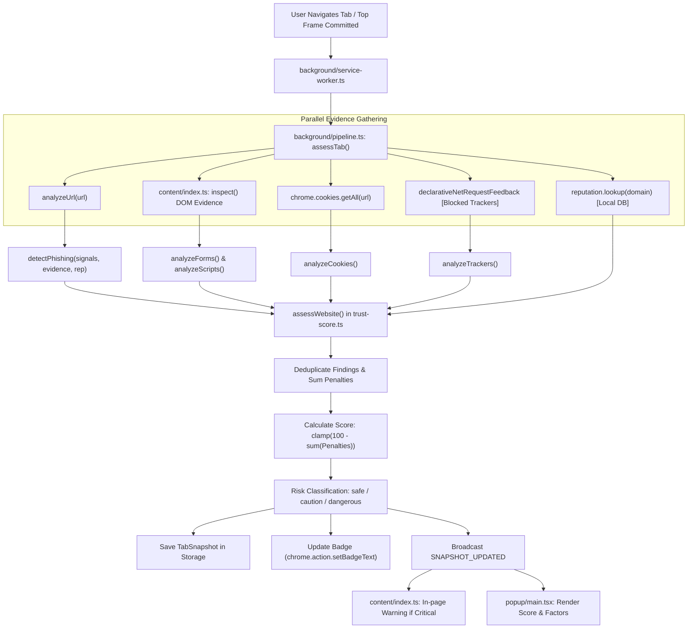

# REA Baseline Audit — Sentinel Browser Security Extension

**Project Name:** Sentinel (`sentinel-trust-guardian`)  
**Target Path:** `d:\p\quard`  
**Manifest Version:** Manifest V3 (`public/manifest.json`)  
**REA Analysis Evidence ID:** `ev_15c67b2f6f30f7f61f7f604a79d82217f3c485a4748c9e3ac1a4be7a5f4ac928`  
**Root Artifact SHA-256:** `2763f2ad11796f33ec14f242bd86d66ba3b8855329250cf749eb07a4d96b1e2f`  
**Audit Date:** 2026-10-22  

---

## 1. Repository Reconnaissance

### 1.1 Complete Project Directory Structure
```
d:\p\quard\
├── ARCHITECTURE.md          # Architectural summary and runtime flow
├── README.md                # Project introduction and quickstart
├── SECURITY.md              # Threat model and privacy guarantees
├── package.json             # NPM dependencies and scripts
├── package-lock.json        # Pinned dependency tree
├── tsconfig.json            # TypeScript 5.6 configuration
├── vite.config.ts           # Vite 5.4 build configuration (popup, options, background)
├── vite.content.config.ts   # Vite configuration for IIFE content script
├── vitest.config.ts         # Vitest test runner configuration
├── tailwind.config.ts       # Tailwind CSS configuration
├── postcss.config.cjs       # PostCSS configuration
├── eslint.config.js         # ESLint flat config
├── popup.html               # Popup entry HTML
├── options.html             # Options page entry HTML
├── scripts/
│   ├── generate-assets.mjs  # Icon and rule asset generation script
│   └── serve-fixtures.mjs   # Test fixture HTTP server
├── public/
│   ├── manifest.json        # Source Manifest V3 file
│   ├── icons/               # Extension icons (16, 32, 48, 128)
│   └── rules/               # Bundled declarativeNetRequest tracker rule files
├── src/
│   ├── background/
│   │   ├── pipeline.ts          # Central orchestration pipeline (assessTab)
│   │   ├── reputation-cache.ts  # In-memory and chrome.storage cache adapter
│   │   └── service-worker.ts    # Background service worker entry point
│   ├── browser/
│   │   ├── cookies.ts           # chrome.cookies adapter (get/delete)
│   │   ├── network-rules.ts     # declarativeNetRequest ruleset synchronization
│   │   ├── permissions.ts       # Permission state & origin check adapter
│   │   └── tabs.ts              # Tab query, badge update, messaging adapter
│   ├── content/
│   │   └── index.ts             # Content script (DOM inspection & form pause)
│   ├── data/
│   │   ├── brands.ts            # Known brand definitions & tokens
│   │   ├── known-bad-domains.json # Bundled local malicious domains list
│   │   ├── trackers.json        # Bundled tracker domain catalog
│   │   └── trusted-providers.ts # Identity & payment providers allowlist
│   ├── options/
│   │   └── main.tsx             # React-based settings page UI
│   ├── popup/
│   │   └── main.tsx             # React-based popup interface
│   ├── reports/
│   │   ├── report-generator.ts  # Sanitized JSON report exporter
│   │   └── report-types.ts      # Export schema types
│   ├── security/
│   │   ├── certificate-checker.ts # Protocol-level TLS observer
│   │   ├── connection-analyzer.ts  # Connection state & mixed content analysis
│   │   ├── cookie-analyzer.ts      # Cookie security attributes analysis
│   │   ├── form-analyzer.ts        # Form destination & sensitivity analysis
│   │   ├── phishing-detector.ts    # URL & DOM phishing heuristics
│   │   ├── reputation.ts           # Pluggable ReputationService & local provider
│   │   ├── risk-classifier.ts      # Score thresholds & severity comparisons
│   │   ├── script-analyzer.ts      # Static script signature analysis
│   │   ├── tracker-detector.ts     # Third-party resource tracker matching
│   │   └── trust-score.ts          # Core 0-100 trust scoring model
│   ├── shared/
│   │   ├── constants.ts         # Thresholds, penalties, lists, storage keys
│   │   ├── messages.ts          # Extension messaging contracts
│   │   ├── types.ts             # Domain models and TypeScript interfaces
│   │   └── validation.ts        # Input sanitization and bounds checking
│   └── styles/
│       └── global.css           # Design tokens, theme variables, Tailwind base
└── tests/
    ├── setup.ts                 # Vitest jsdom setup & mocks
    └── unit/
        ├── network-rules.test.ts # DNR rule sync tests
        ├── trust-score.test.ts   # Baseline trust scoring tests
        └── url-analyzer.test.ts  # URL heuristic parser tests
```

### 1.2 Manifest V3 Configuration (`public/manifest.json`)
* **Manifest Version:** `3`, minimum Chrome version `116`.
* **Permissions:** `storage`, `tabs`, `activeTab`, `scripting`, `cookies`, `webNavigation`, `declarativeNetRequest`, `declarativeNetRequestFeedback`.
* **Host Permissions:** `http://*/*`, `https://*/*`.
* **Content Scripts:** Runs `content/content-script.js` at `document_idle` on all `http://` and `https://` top-level pages (`all_frames: false`).
* **Declarative Net Request Rulesets:** 6 rule files: `analytics` (enabled), `advertising` (enabled), `social` (enabled), `session_replay` (enabled), `fingerprinting` (disabled by default), `strict` (disabled by default).
* **CSP:** `script-src 'self'; object-src 'self'; worker-src 'self'`.

### 1.3 Background Service Worker (`src/background/service-worker.ts`)
* Acts as the event hub for browser navigation (`chrome.webNavigation.onCommitted`), tab closure (`chrome.tabs.onRemoved`), extension lifecycle (`onInstalled`, `onStartup`), and message routing (`chrome.runtime.onMessage`).
* Handles RPC actions: `CONTENT_READY`, `PAGE_EVIDENCE`, `GET_SNAPSHOT`, `RESCAN`, `CHECK_SUBMISSION`, `GET_SETTINGS`, `UPDATE_SETTINGS`, `GET_PROTECTION_STATUS`, `DELETE_COOKIE`, `DELETE_COOKIES`, `GET_HISTORY`, `CLEAR_HISTORY`, `CLEAR_ALL_DATA`, `SET_ALLOWLIST`, `OPEN_OPTIONS`.
* Evaluates form submission safety synchronously before letting forms submit.
* Updates the extension toolbar badge with score and color (green `#0f9f6e`, amber `#b45309`, red `#b91c1c`, slate `#475569`).

### 1.4 Popup UI (`src/popup/main.tsx`)
* Built with React 18 and Lucide icons.
* Shows: Current domain, trust score (0–100), classification badge, connection status, tracker summary, cookie summary, forms/script signals, top score factors, and action buttons ("Protection settings", "Export").
* Lacks: Deep breakdown tabs, detailed evidence inspector, domain registration/age intelligence, certificate details, external threat feeds status, and security headers.

### 1.5 Content Script (`src/content/index.ts`)
* Injected into top frames at `document_idle`.
* Sanitizes metadata: URL, origin, title, forms (action, method, fields, sensitive types), scripts (src, inline pattern matches), resources (images, iframes, stylesheets), and event handlers (`onpaste`, `oncopy`, `onkeydown`).
* Strictly enforces privacy: passwords, card numbers, form values, and keystrokes are never read.
* Renders an in-page floating `#sentinel-warning` alert banner when critical risks or unsafe form submissions are detected.
* Intercepts `submit` events on forms containing sensitive fields and sends `CHECK_SUBMISSION` to background before proceeding.

### 1.6 URL Analysis & Reputation Logic
* `src/security/url-analyzer.ts`: Uses `tldts` for robust domain parsing and `punycode` for IDN conversion. Checks IP hostnames, punycode, mixed scripts, embedded credentials, URL shorteners, suspicious TLDs, login terms, Levenshtein distance against known brand tokens, and excessive subdomains.
* `src/security/reputation.ts`: `ReputationService` coordinates `ReputationProvider`s. Currently only includes `LocalReputationProvider`, matching against `known-bad-domains.json` (version 2026-01).

### 1.7 HTTPS & Certificate-Related Checks
* `src/security/certificate-checker.ts`: Currently observes only `protocol === 'https:'` vs `http:` and reports what Chromium allowed to load.
* Explicitly documents the Chrome extension sandbox limitation: standard web extensions cannot read raw X.509 certificate chains or TLS handshake parameters directly from JavaScript.
* Does not query Certificate Transparency logs (crt.sh) or inspect HTTP security headers (HSTS, CSP, X-Content-Type-Options).

### 1.8 Trust-Score Calculation & Risk Classification
* `src/security/trust-score.ts`:
  * Formula: `score = clampScore(100 - totalPenalty)`.
  * If critical findings or confirmed phishing: clamped to `Math.min(score, 39)`.
  * Classifications:
    * `80–100`: Safe (green)
    * `40–79`: Be Careful / Caution (yellow)
    * `0–39`: Dangerous (red)
    * `unknown`: Non-assessable page or URL-only missing evidence.
  * Finding deduplication merges by ID and takes max severity/confidence.

### 1.9 Storage & Caching
* Local Chrome storage: `sentinel:settings:v1`, `sentinel:history:v1` (bounded to 100 entries), `sentinel:snapshot:<tabId>`, `sentinel:reputation:v1` (24h TTL), `sentinel:deleted-cookies:v1`.
* In-flight promise deduplication in `pipeline.ts` prevents redundant scans during concurrent requests.
* Evidence cache per tab with 12s TTL.

---

## 2. Pipeline Execution Flow

### 2.1 Trace of User Flow
1. User navigates to a URL (or switches tab).
2. `chrome.webNavigation.onCommitted` triggers `assessAndBroadcast(tabId, true)`.
3. In parallel, `content/index.ts` gathers DOM metadata (`inspect()`) and posts `PAGE_EVIDENCE`.
4. `pipeline.ts`:
   - Checks allowlist status.
   - Extracts URL signals via `analyzeUrl()`.
   - Runs local reputation check via `reputation.lookup()`.
   - Reads cookie metadata via `chrome.cookies.getAll()`.
   - Reads matched DNR rules via `declarativeNetRequestFeedback`.
   - Computes phishing signals, form risks, script patterns, and cookie issues.
   - Computes trust score and dedupes findings.
   - Saves snapshot and adds to history.
   - Updates badge color and text.
5. If score is critical (`score <= 39` with critical findings), broadcast message alerts content script to render `#sentinel-warning`.
6. When user clicks popup icon, `popup/main.tsx` requests `GET_SNAPSHOT` and displays findings.

### 2.2 Pipeline Architecture Diagram (Mermaid)



---

## 3. Baseline Validation Findings

### 3.1 Command Execution Verification
All baseline commands were directly executed in the repository:

| Command | Status | Output / Findings |
|---|---|---|
| `npm run typecheck` (`tsc --noEmit`) | **Passed** | 0 TypeScript errors. Exit code 0. |
| `npm test` (`vitest run`) | **Passed** | 3 test files passed, 8 tests passed in 2.21s. Deprecation warning: `[DEP0040] DeprecationWarning: The punycode module is deprecated. Please use a userland alternative instead.` |
| `npm run lint` (`eslint .`) | **Passed** | 0 ESLint errors or warnings. Exit code 0. |
| `npm run build` | **Passed** | Production build successful. Emitted `dist/` with service worker (76.8 kB), content script (6.16 kB), popup (17.6 kB), options (5.2 kB). |
| REA Analysis (`rea-agents analyze-javascript-application`) | **Passed** | Full static semantic graph generated (17 files inventoried, evidence ID: `ev_15c67b2f6f30f7f61f7f604a79d82217f3c485a4748c9e3ac1a4be7a5f4ac928`). |

### 3.2 Supported Features
- Local-first URL heuristic analysis (IP hosts, punycode, Levenshtein brand distance, login terms, long URLs).
- Bundled bad domain reputation matching (`known-bad-domains.json`).
- Declarative Net Request tracking blocker with 6 categories and allowlisting.
- In-page sensitive form submission pause and warning overlay.
- Cookie analysis (SameSite, Secure, HttpOnly, third-party concerns) and selected cookie deletion.
- Deterministic 0–100 trust scoring with explicit finding penalties.
- Sanitized JSON security report export.

### 3.3 Identified Broken or Missing Functionality
1. **No External Threat Intelligence Feeds:** Only bundled static JSON; no integration with live feeds (Google Safe Browsing, URLScan, VirusTotal, or PhishTank).
2. **No Domain Age / Registration Verification:** Does not check registration date or expiry date (RDAP/WHOIS). Young domains (<30 days) are not penalized.
3. **No Certificate Transparency (CT) Auditing:** Cannot tell if a TLS certificate was issued 2 hours ago vs 2 years ago.
4. **No HTTP Security Headers Analysis:** Does not inspect HSTS, CSP, X-Frame-Options, X-Content-Type-Options, or Referrer-Policy.
5. **No DNS Authentication Checks:** Does not query SPF or DMARC records to assess email impersonation risk.
6. **Primitive Linear Subtractive Scoring:** Pure additive penalty deduction `100 - sum(penalties)` without confidence weighting or category caps can produce skewed results on clean domains with minor configuration findings.
7. **Node.js Deprecation Warning:** Node `punycode` module deprecation in tests and builds.
8. **Popup UI Depth:** Popup lacks tabs or expandable inspection of exact headers, certificates, DNS, and WHOIS evidence.
